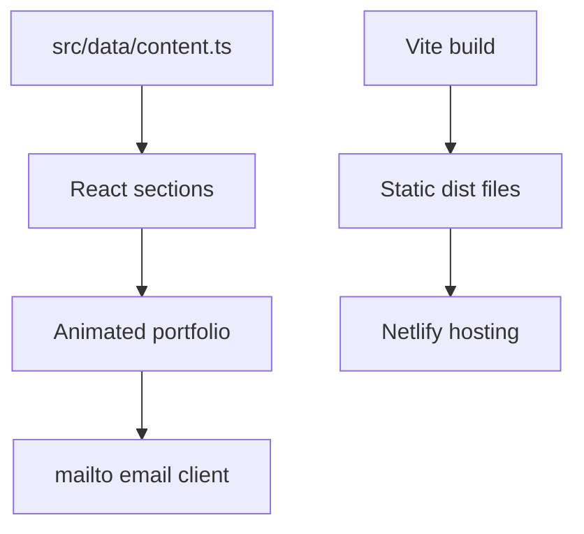

<a id="top"></a>

<div align="center">

# 👨‍💻 Ashish Gije — Portfolio

**An animated React portfolio for projects, skills, education, and contact.**


[Repository](https://github.com/ashishgiije/portfolio) · [Overview](#overview) · [Architecture](#architecture) · [Setup](#setup) · [Validation](#testing-and-validation) · [Audit](AUDIT_REPORT.md)

</div>

## Overview

A personal portfolio intended to help recruiters explore Ashish Gije’s work and background. Content is centralized in `src/data/content.ts`; React sections present projects, achievements, certifications, education, and contact options. Listed personal skills are portfolio content, not dependencies used to build this website.

## Visual preview

**Screenshot placeholder:** No verified application screenshot is supplied here. Capture the landing page and project filter at desktop and mobile sizes. No image is fabricated.

## Key features

- Project category filtering and animated sections.
- Skills, education, achievements, and certificate cards.
- GitHub, LinkedIn, resume, and email links supplied by the content file.
- Contact form opens the visitor’s email client with a prepared message; it does not send mail through a backend.

## Technology stack

| Technology | Role in this checkout |
|---|---|
| React 19 + TypeScript | Component-based interface and typed content |
| Vite 8 | Local development and production bundling |
| Tailwind CSS 4 | Styling |
| Framer Motion + Lucide | Animations and interface icons |
| Netlify | Static build configuration |

## Architecture



## Application workflow

Browse sections → filter projects → inspect certificates or resume → follow a project link or open an email draft.

## Setup

```bash
git clone https://github.com/ashishgiije/portfolio.git
cd portfolio
```

Use Node.js 22.12+ or Node.js 24, and npm. Vite 8 requires a sufficiently recent runtime.

```bash
npm ci
npm run dev
```

Open the Vite URL (normally `http://localhost:5173`).

```bash
npm run build
npm run preview
```

Netlify runs `npm run build` and publishes `dist`. Its committed `NODE_VERSION = "20"` needs a supported 20.19+ patch or a newer runtime. No application secrets or database are needed.

## Project structure

```text
src/data/content.ts  # Editable portfolio content
src/components/      # Portfolio sections and icons
src/App.tsx          # Page composition
public/certificates/ # Certificate assets
netlify.toml         # Hosting build settings
```

## Content maintenance

Update projects and professional links in `src/data/content.ts`. Replace self-reported accuracy claims with reproducible evaluation links before presenting them as measured results. Certificate image files exist, but their presence does not independently verify a qualification.

## Testing and validation

Current source review and checks (4 November 2026):

`npm ci` and `npm run build` passed (TypeScript and Vite). No automated browser suite is defined. HTTP GET / returned 200 and expected page content

Use the setup commands above and the documented workflow for a local smoke check. No passing automated application suite is claimed where none exists.

## Limitations and roadmap

- Implemented: static portfolio and mailto contact handoff.
- No server-side contact delivery, CMS, database, or authentication.
- Project accuracy statements in content are not validated benchmarks; see the audit.
- Suggested roadmap: add project-specific links, documented evaluation evidence, and browser/accessibility checks.

<details>
<summary>Troubleshooting and contributions</summary>

Check the runtime versions and working directory first. For dependency installation failures, preserve TLS and checksum verification and inspect the first error. For external services, verify your local configuration and account permissions without sharing secret values.

Before contributing, read [the audit](AUDIT_REPORT.md), reproduce the affected behavior, and keep documentation changes separate from application fixes. Add tests for changed behavior and describe remaining limitations accurately.

</details>

## Author

**Ashish Gije** · [GitHub](https://github.com/ashishgiije)

[Back to top](#top)
